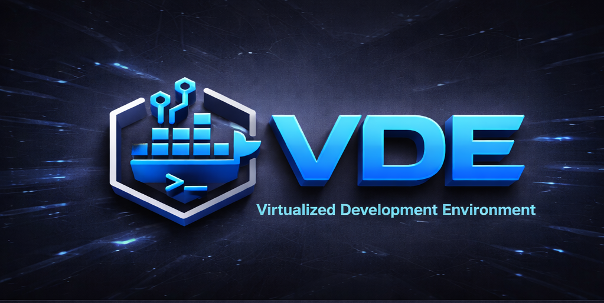

# GETTING STARTED
<!-- @armor (Student Documentation) -->
<p align="center"></p>

# VDE Getting Started: The Path of the Foundling

Welcome to the **Virtualized Development Environment (VDE)**. This guide is your map to forging a sovereign development ecosystem.

---

## 1. Onboarding: The Path of the Foundling

**One command gets you everything:**

```zsh
bash <(curl -sL https://raw.githubusercontent.com/dderyldowney/vde-system/stable/scripts/bootstrap.sh)
```

This checks your system, clones VDE, and launches the onboarding ritual. If anything's missing, it tells you exactly what to install.

> **Want your code to live somewhere other than inside the VDE install? Decide now.** The **Projects base** is the directory under which VDE creates a per-VM subfolder (`<base>/<alias>`) that is mounted into each environment as your workspace. Point it at your own folder — `~/Projects`, `~/GitHub`, wherever your work already lives — and your code stays where *you* want it; if a same-named folder already exists there, VDE adopts and coexists with it, never overwriting your work.
>
> The installer is **non-interactive** (it never prompts), so this is your one unattended chance to choose: pass `--projects-dir` now, or pre-export `VDE_PROJECTS_DIR` before running it (the flag wins if both are set). Omit both and you silently get the default `<VDE>/projects`. You can always change it later with `vde set-projects-dir <path>`.
>
> ```zsh
> # Pass the flag directly (recommended):
> bash <(curl -sL https://raw.githubusercontent.com/dderyldowney/vde-system/stable/scripts/bootstrap.sh) --projects-dir ~/Projects
>
> # ...or pre-export the environment variable:
> export VDE_PROJECTS_DIR=~/Projects
> bash <(curl -sL https://raw.githubusercontent.com/dderyldowney/vde-system/stable/scripts/bootstrap.sh)
> ```

The onboarding ritual (`path-of-the-foundling`) then walks you through the lifecycle:
1.  **`vde init`**: The Initialization Ritual. Hydrates your Hub and generates your `vde_student` SSH identity key.
2.  **`vde create <alias>`**: The Smelting Ritual. Creates an immutable Docker image for a Spoke.
3.  **`vde start <alias>`**: The Ignition Ritual. Brings the Spoke to life as a running container.
4.  **`vde enter <alias>`**: The Sovereign Handshake. Securely enters the Spoke as the `devuser` via the SSH bridge.
5.  **`vde stop <alias>`**: The Quenching Ritual. Safely stops the Spoke.
6.  **`vde rm <alias>`**: The Dissolution Ritual. Removes the Spoke instance.

---

## 2. Daily Development Workflows

### Your Workspace
Inside any Spoke, you operate as the `devuser`. Your code lives at `$HOME/workspace/`. This directory is **persistently synced** to `projects/<alias>` on your host machine. Save your work here to ensure it survives Spoke rebuilds.

> **Your Projects base:** The `projects/` folder above sits under a **Projects base** you choose during onboarding (the Path of the Foundling). Each Spoke's alias becomes its own subfolder beneath that base — `<base>/rust`, `<base>/python`, and so on — and that subfolder is bind-mounted into the Spoke at `$HOME/workspace/`. Anything you save inside the Spoke appears on your host under the base, and anything you drop into the base from the host appears inside the Spoke.
>
> The base defaults to `$VDE_ROOT/projects`, but it may be **any directory you control**, inside or outside the Forge — `~/Projects`, `~/code/vde`, wherever your work already lives. VDE never overwrites or deletes what is already there: it only *adds* its `<base>/<alias>` subfolders, and if a folder of that name already exists it is **adopted** (used as-is), never clobbered. So you can point VDE straight at a directory where you already keep projects.
>
> To move the base later, run `vde set-projects-dir <new-path>`. It safely **moves** your existing alias folders to the new base (skipping any name collision, never overwriting or deleting), updates your `.env`, and regenerates Spoke configs — your Spokes use the new location on their next start, with no image rebuild. Power users can see [Advanced Usage](advanced-usage.md) for the `--projects-dir` flag and `VDE_PROJECTS_DIR` override.
>
> Your work is yours: `vde nuke` (below) tears down VDE's own state but **never** touches your `projects/` base or your `data/` — see the Foundling Guide for the full onboarding story.

### Clusters and Discovery
VDE supports multi-Spoke tech stacks:
```vde start python postgres redis```
Spokes discover each other automatically by name. Python can reach Postgres at `vde-postgres` and Redis at `vde-redis`.

### The Sovereign Bridge (`vde-host`)
To access services on your host computer (the Hub) or the internet bridge, use `vde-host`.

---

## 3. The Beskar Vault (Directory Structure)

| Directory | Project | Purpose |
| :--- | :--- | :--- |
| `projects/` | `@armor` | **YOUR CODE LIVES HERE.** Persistent and synced. This is the default Projects base; it may be relocated anywhere you control via `vde set-projects-dir`. Survives `vde nuke`. |
| `data/` | `@armor` | Database persistence (Postgres/Redis volumes). Also survives `vde nuke`. |
| `bin/` | `@shared-law` | The `vde` command suite. |
| `env-files/` | `@shared-law` | Configuration for your Spokes. |

---

## 4. Essential Rituals Reference

| Command | Action |
| :--- | :--- |
| `vde list` | Audit all registered and active Spokes. |
| `vde info <alias>` | Inspect the configuration of a specific Spoke. |
| `vde rebuild <alias>` | Re-smelt a Spoke image from its Dockerfile (reuses Docker cache; pass `--no-cache` for a clean rebuild). |
| `vde set-projects-dir <path>` | Re-point your Projects base; moves existing alias folders to the new base (skips collisions, never deletes). |
| `vde health` | Run System Spine health checks (Spine Check). |
| `vde dns-check` | Verify cross-Spoke DNS resolution. |
| `vde nuke` | **The Great Quench**: Safe removal of all VDE artifacts. Offers to relocate your `projects/` and `data/` first, and never deletes them. |

**This is the Way.**
